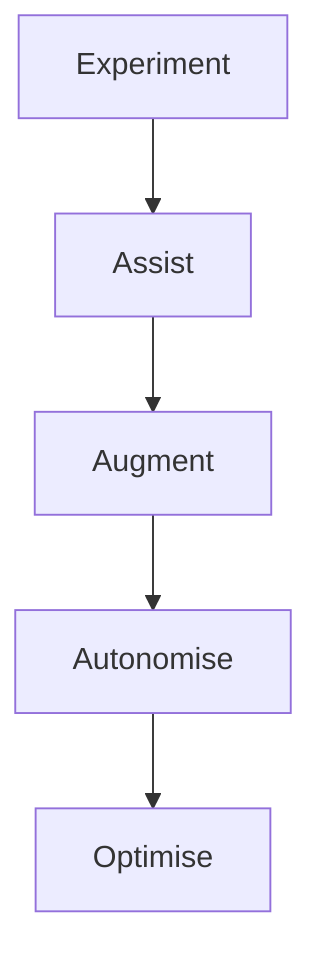

# AI Value Realisation Model™

*A practical framework for moving from AI experimentation to measurable business outcomes.*

---

## Executive Summary

Organisations are investing heavily in artificial intelligence. Yet many initiatives remain trapped in pilot mode.

Leaders frequently report:

- Successful proofs of concept
- Positive user feedback
- Strong executive sponsorship
- Growing AI investment

But limited enterprise value.

The challenge is rarely the AI itself.

The challenge is moving from experimentation to measurable business outcomes while maintaining trust, governance, and organisational readiness.

The AI Value Realisation Model™ provides a structured approach for increasing AI maturity without sacrificing customer trust, operational control, or long-term sustainability.

---

# Why Most AI Programmes Struggle to Scale

Most AI strategies focus on technology adoption.

Successful AI transformations focus on organisational adoption.

Technology alone does not create value.

Value emerges when organisations align:

- Customer needs
- Employee workflows
- Operational processes
- Trust and governance
- Knowledge management
- Business objectives

The most successful organisations do not deploy more AI.

They deploy AI more deliberately.

---

# The AI Value Realisation Model™

The model recognises that AI adoption is not a technology journey.

It is an organisational capability journey.

Each stage builds on the foundation established in the previous stage.

---

# Stage 1: Experiment

## Executive Question

**Can this technology solve a real business problem?**

At this stage, organisations explore new capabilities through controlled experimentation.

The goal is learning, not scale.

### Typical Characteristics

- Proofs of concept
- Small pilot programmes
- Limited user groups
- Experimental governance

### Common Contact Centre Use Cases

- Internal AI assistants
- Call summarisation pilots
- Knowledge search prototypes
- Customer-service chatbots

### Success Metrics

- Pilot completion rate
- User satisfaction
- Proof-of-concept outcomes
- Business feasibility

### Typical Risks

- Technology looking for a problem
- Weak business sponsorship
- Lack of success criteria
- No path to production

### Executive Recommendation

Focus less on technical performance and more on business relevance.

A successful pilot should answer:

> What measurable business problem are we solving?

---

# Stage 2: Assist

## Executive Question

**Can AI improve how people work?**

At this stage, AI acts as a co-pilot.

Humans remain accountable for every decision.

The focus shifts from learning to productivity improvement.

### Common Contact Centre Use Cases

- Agent Assist
- Conversation summaries
- Suggested responses
- Knowledge recommendations
- Next Best Action

### Success Metrics

- Reduced after-call work
- Reduced handle time
- Faster onboarding
- Improved employee experience

### Typical Risks

- Low adoption
- Recommendation fatigue
- Lack of trust
- Poor workflow integration

### Executive Recommendation

Measure adoption before return on investment.

AI creates value only when employees actively use it.

---

# Stage 3: Augment

## Executive Question

**Can AI improve decision quality?**

At this stage, AI becomes embedded in operational workflows.

It actively improves customer and employee outcomes.

### Common Contact Centre Use Cases

- Predictive routing
- Customer intent prediction
- Intelligent quality management
- Behavioural analytics
- AI-driven coaching

### Success Metrics

- First Contact Resolution
- Customer Satisfaction
- Escalation reduction
- Employee productivity
- Service consistency

### Typical Risks

- Fragmented knowledge
- Inconsistent data quality
- Poor change management
- Lack of governance

### Executive Recommendation

Treat knowledge and data quality as strategic assets.

Most AI programmes struggle at this stage because the underlying foundations are not mature enough to support intelligent decision-making.

---

# Stage 4: Autonomise

## Executive Question

**What decisions can AI make safely?**

Organisations begin delegating defined decisions and workflows to AI systems.

Human oversight remains essential.

### Common Contact Centre Use Cases

- Autonomous service interactions
- Workflow automation
- Case resolution automation
- Intelligent fulfilment processes

### Success Metrics

- Automation rate
- Containment rate
- Resolution speed
- Cost-to-serve reduction

### Typical Risks

- Customer trust erosion
- Compliance failures
- Lack of explainability
- Governance breakdowns

### Executive Recommendation

Every autonomous decision requires:

- Clear accountability
- Human escalation paths
- Auditability
- Risk controls

Autonomy without trust destroys value.

---

# Stage 5: Optimise

## Executive Question

**Can AI continuously improve organisational performance?**

At this stage, AI becomes an enterprise capability rather than a technology initiative.

The focus shifts from automation toward optimisation.

### Characteristics

- Continuous learning
- Real-time optimisation
- Closed-loop feedback
- Enterprise intelligence

### Success Metrics

- Customer retention
- Revenue impact
- Customer lifetime value
- Enterprise productivity
- Strategic agility

### Typical Risks

- Governance complexity
- Model drift
- Organisational complacency
- Diminishing oversight

### Executive Recommendation

Create a permanent AI operating model.

The organisations creating long-term value institutionalise AI rather than managing it as a project.

---

# The Four Foundations of Successful AI Adoption

Regardless of maturity stage, four foundational capabilities determine success.

---

## Foundation 1: Trust

### Key Questions

- Do customers trust AI decisions?
- Do employees trust recommendations?
- Can decisions be explained?

### Why It Matters

Trust is the gateway to adoption.

Without trust, utilisation declines regardless of technical capability.

---

## Foundation 2: Knowledge

### Key Questions

- Is information accurate?
- Is information current?
- Is information accessible?

### Why It Matters

Poor knowledge produces poor AI.

Most AI quality problems are knowledge problems in disguise.

---

## Foundation 3: Governance

### Key Questions

- Who owns AI outcomes?
- How are decisions monitored?
- How are risks managed?
- What controls are in place?

### Why It Matters

Governance does not slow adoption.

It enables sustainable adoption.

---

## Foundation 4: Workforce Readiness

### Key Questions

- Do employees understand the technology?
- Have workflows changed?
- Are incentives aligned?
- Have leaders adapted their management approach?

### Why It Matters

Technology adoption remains fundamentally a people challenge.

---

# Common Executive Mistakes

## Mistake 1: Treating AI as a Technology Strategy

Many organisations create AI strategies.

The highest-performing organisations create business strategies enabled by AI.

---

## Mistake 2: Focusing on Use Cases Instead of Adoption

Most organisations already have enough use cases.

The challenge is achieving enterprise-wide adoption and value realisation.

---

## Mistake 3: Equating Automation with Success

Automation is an activity metric.

Business outcomes are success metrics.

---

## Mistake 4: Viewing AI Primarily as a Cost Reduction Tool

The greatest value often comes from:

- Better decisions
- Improved customer experiences
- Increased employee effectiveness
- Faster innovation

Not simply lower headcount.

---

# Applying the Model to Contact Centres

| Maturity Stage | Primary Goal | Illustrative Example |
|---------------|--------------|----------------------|
| Experiment | Validate value | Knowledge chatbot pilot |
| Assist | Improve agent productivity | Agent Assist |
| Augment | Improve decision quality | Predictive Routing |
| Autonomise | Automate workflows | Autonomous service journeys |
| Optimise | Continuous improvement | AI-driven CX optimisation |

---

# Strategic Implications for Leaders

The next generation of customer service organisations will not be defined by how much AI they deploy.

They will be defined by how effectively they integrate AI into:

- Customer journeys
- Employee workflows
- Knowledge ecosystems
- Governance models
- Operating structures

AI is not the destination.

It is an enabling capability.

The real objective is creating better outcomes for customers, employees, and the enterprise.

---

# My Perspective

After leading AI, customer experience, product strategy, and contact-centre transformation initiatives across regulated industries, I have observed that AI rarely fails because of technology.

It fails because organisations attempt to scale automation before establishing trust, knowledge, governance, and workforce readiness.

The organisations creating the greatest value are not those deploying the most AI.

They are those building the capabilities required to sustain AI at scale.

---

# Key Takeaway

> The journey from AI experimentation to enterprise value is not defined by technology maturity. It is defined by organisational readiness. Trust, knowledge, governance, and workforce adoption determine whether AI becomes a strategic advantage or another promising pilot that never scales.

---

## Author

**Sugandha Mallik**

*Product Strategy • AI Transformation • Customer Experience • Contact Centre Modernisation*

17+ years across banking, fintech, and regulated industries delivering customer, operational, and commercial transformation at global scale.