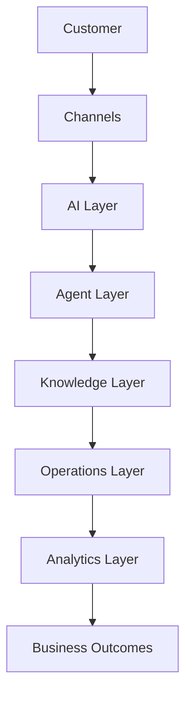

# Contact Center Operating Model Framework

*A strategic framework for aligning customer experience, AI, workforce design, operational excellence, and business outcomes.*

---

## Executive Summary

Many contact centre transformation programmes focus on implementing technology. While these initiatives often achieve successful deployments, they frequently fail to deliver sustainable business value.

The Contact Center Operating Model (CCOM) provides a holistic framework that shifts the focus from technology implementation to outcome realisation. It recognises that customer experience, artificial intelligence, human expertise, knowledge management, operations, and analytics must function as an integrated system to produce lasting commercial results.

The framework is built on a simple premise:

> A contact centre does not become more effective by adding AI. It becomes more effective when customer journeys, AI capabilities, human expertise, operational processes, and organisational objectives are aligned as a single system.

---

# The Contact Center Operating Model



Unlike traditional operating models that centre on technology platforms, the CCOM begins with the customer and ends with measurable business impact.

---

# Purpose

## Why This Framework Exists

Organisations often approach transformation as a series of technology projects:

- Implement a new platform
- Deploy a chatbot
- Introduce agent assist
- Migrate to the cloud

These initiatives can create capability, but capability alone does not guarantee outcomes.

The Contact Center Operating Model helps leaders understand how every component of the customer service ecosystem contributes to business value. It provides a structured view of how customer experience, AI, workforce design, knowledge management, operations, and analytics interact to create sustainable results.

---

## Core Principles

### Customer First

Every capability must improve the customer journey.

### Outcomes Before Technology

Technology investments should be tied to customer, operational, and commercial objectives from day one.

### Human and AI Collaboration

AI should augment human expertise rather than simply automate interactions.

### Knowledge as a Strategic Asset

Effective service depends on the availability, quality, and accessibility of knowledge.

### Continuous Learning

Insights generated from customer interactions should continuously improve products, services, and operations.

---

# Layer Definitions

## 1. Customer Layer

### Purpose

Understand customer intent, expectations, behaviour, and desired outcomes.

### Key Questions

- Why are customers contacting us?
- What are they trying to achieve?
- Where does friction exist?
- What drives trust and loyalty?

### Key Deliverables

- Customer journey maps
- Voice of customer programmes
- Segmentation models
- Customer outcome definitions

---

## 2. Experience Layer

### Purpose

Design seamless and consistent experiences across customer touchpoints.

### Focus Areas

- Omnichannel engagement
- Personalisation
- Effort reduction
- Consistent service delivery

### Success Criteria

Customers experience one relationship with the organisation rather than multiple disconnected channels.

---

## 3. AI Layer

### Purpose

Improve customer and agent outcomes through intelligent automation.

### Typical Capabilities

- Conversational AI
- Agent Assist
- Predictive Routing
- Knowledge Copilots
- Next Best Action
- Quality Intelligence

### Success Criteria

AI improves service quality, efficiency, and decision-making without eroding customer trust.

---

## 4. Agent Layer

### Purpose

Provide empathy, judgement, expertise, and exception handling.

### Future State

The role of the agent evolves from transaction processing to problem solving and value creation.

### Key Capabilities

- Complex issue resolution
- Relationship management
- Emotional intelligence
- Decision support

### Success Criteria

Agents focus on high-value interactions where human judgement matters most.

---

## 5. Knowledge Layer

### Purpose

Ensure accurate information is available at the right moment for both customers and employees.

### Why It Matters

Many AI initiatives fail not because the models are inadequate, but because organisational knowledge is fragmented, outdated, or inaccessible.

### Key Components

- Knowledge repositories
- Governance
- Content management
- Search and retrieval
- Knowledge quality metrics

### Success Criteria

A single trusted source of truth.

---

## 6. Operations Layer

### Purpose

Deliver reliability, scalability, compliance, and operational efficiency.

### Components

- Workforce Management
- Quality Assurance
- Risk Management
- Regulatory Compliance
- Capacity Planning
- Service Governance

### Success Criteria

Operational excellence supports growth without sacrificing customer experience.

---

## 7. Insights Layer

### Purpose

Transform data into actionable intelligence.

### Key Inputs

- Customer feedback
- Interaction analytics
- Operational performance
- AI performance metrics

### Key Outputs

- Strategic recommendations
- Service improvements
- Product insights
- Workforce optimisation opportunities

### Success Criteria

Every customer interaction contributes to organisational learning.

---

## 8. Business Outcomes Layer

### Purpose

Measure whether investments are creating sustainable value.

### Outcome Categories

#### Customer Outcomes

- Higher satisfaction
- Higher loyalty
- Reduced effort
- Increased trust

#### Operational Outcomes

- Improved productivity
- Faster resolution
- Lower operating cost
- Better service consistency

#### Commercial Outcomes

- Revenue growth
- Cost savings
- Retention improvement
- Greater profitability

---

# Success Metrics

## Customer Metrics

| Metric | Purpose |
|----------|----------|
| CSAT | Measure customer satisfaction |
| NPS | Measure customer loyalty |
| CES | Measure customer effort |
| Complaint Rate | Measure friction |

**Success looks like:** Higher trust, lower effort, and stronger customer loyalty.

---

## Operational Metrics

| Metric | Purpose |
|----------|----------|
| Average Handle Time | Operational efficiency |
| First Contact Resolution | Resolution effectiveness |
| Service Level | Accessibility |
| Abandonment Rate | Queue performance |

**Success looks like:** Faster issue resolution and improved service consistency.

---

## Workforce Metrics

| Metric | Purpose |
|----------|----------|
| Agent Satisfaction | Workforce engagement |
| Attrition Rate | Workforce stability |
| Occupancy Rate | Workforce utilisation |
| Time to Competency | Training effectiveness |

**Success looks like:** Better retention, stronger capability, and reduced burnout.

---

## AI Metrics

| Metric | Purpose |
|----------|----------|
| Automation Rate | AI effectiveness |
| Containment Rate | Self-service success |
| Recommendation Acceptance | Agent Assist adoption |
| Knowledge Accuracy | Information quality |
| Hallucination Rate | AI reliability |

**Success looks like:** AI improves outcomes rather than simply increasing automation.

---

## Commercial Metrics

| Metric | Purpose |
|----------|----------|
| Cost to Serve | Efficiency |
| Revenue Retention | Customer value |
| Conversion Rate | Commercial impact |
| Annualised Savings | Financial returns |

**Success looks like:** Sustainable business value creation.

---

# Key Risks

## Risk 1: Technology-Led Transformation

### Symptom

Organisations deploy new technology without clearly defining desired business outcomes.

### Result

Successful implementation with limited business impact.

### Mitigation

Define customer, operational, and commercial outcomes before selecting technology.

---

## Risk 2: Fragmented Knowledge

### Symptom

Multiple sources of truth and inconsistent information.

### Result

Poor customer experiences and ineffective AI solutions.

### Mitigation

Treat knowledge management as a strategic capability rather than a support function.

---

## Risk 3: AI Trust Deficit

### Symptom

Customers avoid self-service channels and agents ignore AI recommendations.

### Result

Low adoption and unrealised value.

### Mitigation

Build transparency, governance, and explainability into every AI solution.

---

## Risk 4: Workforce Resistance

### Symptom

Low adoption of transformation initiatives.

### Result

Shadow processes and inconsistent outcomes.

### Mitigation

Design AI and automation around human workflows rather than replacing them outright.

---

## Risk 5: Local Optimisation

### Symptom

One metric improves while another deteriorates.

### Example

Reduced Average Handle Time causes lower customer satisfaction.

### Mitigation

Measure end-to-end business outcomes rather than isolated KPIs.

---

# Operating Model Implications

## Leadership Implications

The future contact centre cannot be led solely as an operational function.

Leaders must be capable of connecting:

- Customer Experience
- Product Strategy
- AI Transformation
- Workforce Design
- Data and Analytics

Success requires balancing customer value, operational resilience, and commercial outcomes.

---

## Workforce Implications

The evolution of agent roles can be represented as:

```text
Transaction Processor
         ↓
Knowledge Worker
         ↓
Problem Solver
         ↓
Customer Advisor
```

Future workforce strategies must focus on augmentation rather than replacement.

---

## Technology Implications

Future-ready architectures require:

- Cloud-native platforms
- AI orchestration capabilities
- Integrated data ecosystems
- Enterprise knowledge platforms
- Open integration frameworks

Technology becomes an interconnected ecosystem rather than a collection of tools.

---

## Governance Implications

AI-driven contact centres require stronger governance capabilities, including:

- Responsible AI controls
- Security and privacy standards
- Explainability requirements
- Compliance oversight
- Model monitoring processes

Governance becomes a business capability rather than an IT function.

---

## Strategic Implications

The modern contact centre should no longer be viewed as a cost centre.

Instead, it becomes a strategic intelligence hub that helps organisations:

- Understand customers
- Improve products
- Identify revenue opportunities
- Strengthen customer trust
- Drive sustainable growth

---

# Conclusion

The future of contact centre transformation is not defined by AI, automation, or cloud platforms in isolation.

It is defined by how effectively organisations align customer experience, human expertise, intelligent automation, operational excellence, and business outcomes into a single operating model.

The organisations that succeed will not be those with the most advanced technology. They will be those that create the strongest connection between technology investments, customer value, and business results.

---

## Author

**Sugandha Mallik**

Product Strategy • Customer Experience • AI Transformation • Contact Center Modernisation

17+ years across banking, fintech, and regulated industries delivering customer, operational, and commercial transformation at global scale.
