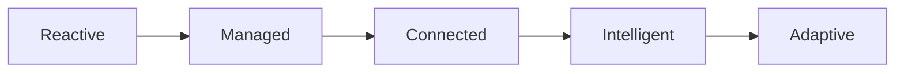

# Customer Experience Maturity Model™

*A practical framework for assessing an organisation's ability to create sustainable customer value at scale.*

---

# Executive Summary

Most organisations invest heavily in customer experience.

They launch new channels.

Modernise platforms.

Deploy AI solutions.

Redesign journeys.

Implement voice-of-customer programmes.

Yet many struggle to produce lasting improvements in customer trust, loyalty, or business performance.

The challenge is not a lack of investment.

The challenge is maturity.

Customer experience is not a programme.

It is an organisational capability.

The Customer Experience Maturity Model™ helps leaders assess where they are today and identify the capabilities required to create sustainable customer and business outcomes.

---

# The Customer Experience Maturity Model™

    
| Stage | Primary Focus | Key Question |
|---------|---------|---------|
| Reactive | Service Recovery | How effectively do we respond when customers have problems? |
| Managed | Consistency | Can we deliver experiences consistently? |
| Connected | Journey Integration | Can customers experience one organisation across channels? |
| Intelligent | Prediction | Can we anticipate customer needs? |
| Adaptive | Continuous Learning | Can we continuously evolve from customer insight? |

---

The model reflects the progression from managing individual customer interactions to operating a continuously learning customer-centric enterprise.

---

# Level 1: Reactive

## Executive Question

**Are we responding effectively when customers experience problems?**

At this stage customer experience is largely operational.

Efforts focus on resolving issues after they occur.

---

## Characteristics

- Channel-centric operations
- Siloed customer information
- Limited customer insight
- Success measured by operational metrics

---

## Typical Metrics

- Average Handle Time
- Service Level
- Complaint Volume
- Escalation Volume

---

## Common Challenges

- High effort experiences
- Inconsistent service delivery
- Limited visibility into customer journeys
- Low organisational alignment

---

## Leadership Priority

Move beyond operational efficiency and begin understanding customer outcomes.

---

# Level 2: Managed

## Executive Question

**Can we consistently deliver customer experiences?**

Customer experience becomes a recognised business capability.

Organisations establish governance, processes, and measurement frameworks.

---

## Characteristics

- Defined customer journeys
- Voice of Customer programmes
- CX targets and reporting
- Formal ownership structures

---

## Typical Metrics

- CSAT
- NPS
- Customer Effort Score
- First Contact Resolution

---

## Common Challenges

- Siloed improvement programmes
- Disconnected channels
- Manual insight generation

---

## Leadership Priority

Create consistency across customer journeys rather than optimising individual touchpoints.

---

# Level 3: Connected

## Executive Question

**Can customers experience a single organisation regardless of channel?**

At this stage customer experience becomes integrated across touchpoints.

The organisation begins connecting operational, customer, and technology strategies.

---

## Characteristics

- Omnichannel engagement
- Unified customer view
- Cross-functional ownership
- Journey-based decision making

---

## Typical Metrics

- Journey completion rate
- Channel switching rate
- Customer retention
- Customer lifetime value

---

## Common Challenges

- Complex technology landscape
- Data integration issues
- Fragmented ownership models

---

## Leadership Priority

Align customer, technology, and operational strategies around common outcomes.

---

# Level 4: Intelligent

## Executive Question

**Can we anticipate customer needs before they become customer requests?**

The organisation uses data, analytics, and AI to proactively improve experiences.

Decision-making becomes increasingly predictive rather than reactive.

---

## Characteristics

- AI-enabled personalisation
- Predictive service models
- Intelligent routing
- Behaviour-driven engagement

---

## Typical Metrics

- Proactive resolution rate
- Prediction accuracy
- Personalisation effectiveness
- Customer retention improvement

---

## Common Challenges

- AI governance
- Trust and transparency
- Operational readiness
- Data quality

---

## Leadership Priority

Ensure AI enhances customer trust rather than simply increasing automation.

---

# Level 5: Adaptive

## Executive Question

**Can our organisation continuously learn and improve through every customer interaction?**

At the highest maturity level, customer experience becomes an enterprise capability.

Every interaction contributes to business learning.

---

## Characteristics

- Continuous feedback loops
- Real-time optimisation
- Embedded customer intelligence
- Enterprise-wide customer centricity

---

## Typical Metrics

- Customer lifetime value growth
- Trust index
- Loyalty growth
- Revenue retention

---

## Common Challenges

- Governance at scale
- Complexity management
- Maintaining organisational alignment

---

## Leadership Priority

Sustain adaptability without creating organisational complexity.

---

# The Four Dimensions of Maturity

Customer experience maturity is determined across four foundational dimensions.

---

# 1. Customer Trust

### Key Question

Do customers trust the organisation to deliver consistently and transparently?

### Indicators

- Loyalty
- Retention
- Advocacy
- Brand confidence

Without trust, every customer interaction becomes more expensive.

---

# 2. Customer Intelligence

### Key Question

How effectively does the organisation learn from customer behaviour?

### Indicators

- Voice of Customer maturity
- Customer analytics
- Journey insights
- Predictive capabilities

Experience improvement requires insight.

Insight requires data.

---

# 3. Technology Enablement

### Key Question

Does technology accelerate customer outcomes?

### Indicators

- Omnichannel capabilities
- AI adoption
- Data integration
- Automation capability

Technology should enable experiences rather than define them.

---

# 4. Operating Model

### Key Question

Can the organisation consistently deliver customer-centric outcomes?

### Indicators

- Governance
- Accountability
- Workforce readiness
- Cross-functional collaboration

Customer experience is ultimately an operating model challenge.

---

# Common Executive Mistakes

## Mistake 1

Treating customer experience as a channel strategy.

Customers experience the organisation, not the channel.

---

## Mistake 2

Measuring customer experience solely through satisfaction scores.

Satisfaction is an outcome.

Not a strategy.

---

## Mistake 3

Implementing AI before understanding customer journeys.

Intelligent automation amplifies broken experiences if underlying journeys are flawed.

---

## Mistake 4

Optimising individual touchpoints rather than entire journeys.

Customers remember outcomes, not operational boundaries.

---

# Applying the Model in Contact Centres

| Maturity Stage | Primary Focus | Typical Operating Model |
|---------------|--------------|--------------------------|
| Reactive | Service delivery | Channel management |
| Managed | Performance management | Process optimisation |
| Connected | Journey orchestration | Omnichannel operations |
| Intelligent | Predictive experience | AI-enabled service |
| Adaptive | Continuous learning | Customer intelligence hub |

---

# Strategic Implications

The future of customer experience is not defined by digital channels, AI, or contact centre technology.

It is defined by the organisation's ability to continuously understand, anticipate, and respond to customer needs.

The highest-performing organisations do not simply manage customer interactions.

They build systems that continuously learn from them.

---

# My Perspective

After leading customer experience, AI, product strategy, and contact-centre transformation initiatives across regulated industries, I have found that customer experience maturity is less about deploying new technology and more about creating organisational alignment.

The organisations that outperform their competitors consistently connect customer insight, workforce capabilities, technology investments, and governance structures into a single operating model.

Customer experience is not a department.

It is a business capability.

---

# Key Takeaway

> Customer experience maturity is not measured by the sophistication of channels or technology. It is measured by an organisation's ability to continuously create trust, reduce friction, anticipate needs, and transform customer insight into business value.

---

## Author

**Sugandha Mallik**

*Product Strategy • Customer Experience • AI Transformation • Contact Centre Modernisation*

17+ years across banking, fintech, and regulated industries delivering customer, operational, and commercial transformation at global scale.